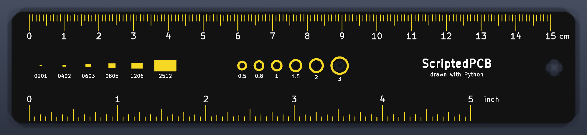
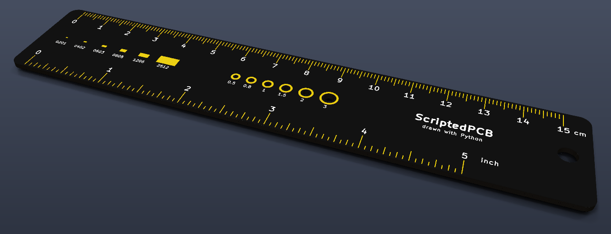
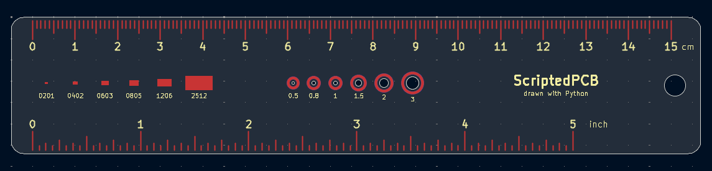

# KiCad PCB ruler generator (Python)

A real, manufacturable **15 cm / 5 inch PCB ruler**, drawn entirely by a Python script with KiCad's `pcbnew` API: 288 objects, zero clicks, **0 DRC errors**.



- 151 millimetre ticks and an 81-tick inch scale (1/16")
- SMD package size gauge: 0201, 0402, 0603, 0805, 1206, 2512 (real body sizes)
- Drill gauge: 0.5 to 3 mm real holes with copper rings
- Exposed gold copper (ENIG) through the solder mask, optional black mask
- Clean DRC: copper kept 0.75 mm from the board edge

📖 **Step-by-step tutorial** (every function explained): [scriptedpcb.com — PCB ruler with Python](https://scriptedpcb.com/en/projects/pcb-ruler-python-kicad/)
🎬 **Video walkthrough**: [Build a PCB Ruler with Python in KiCad (Step by Step)](https://youtu.be/3DMbfdIgksg)

## Usage

Run the script with the **Python bundled with KiCad** (a plain system Python can't `import pcbnew`):

```bash
# Windows
"C:\Program Files\KiCad\10.0\bin\python.exe" pcb_ruler.py --out pcb_ruler.kicad_pcb --black

# macOS / Linux: use the Python that ships with KiCad
python3 pcb_ruler.py --out pcb_ruler.kicad_pcb
```

| Option | Effect |
|---|---|
| `--out FILE` | Output board file (default `pcb_ruler.kicad_pcb`) |
| `--black` | Black solder mask, white silkscreen, ENIG finish in the board stackup |

Then open the board in KiCad, or check it from the command line:

```bash
kicad-cli pcb drc --exit-code-violations -o drc.rpt pcb_ruler.kicad_pcb   # exit code 0 = clean
kicad-cli pcb render --use-board-stackup-colors --quality high -o ruler.png pcb_ruler.kicad_pcb
```

Getting `No module named 'pcbnew'`? See [this troubleshooting guide](https://scriptedpcb.com/en/pcbnew/fix-no-module-named-pcbnew/).



## How it works

Each tick is a segment whose length depends only on its position — one loop and a modulo:

```python
for i in range(151):                                   # one tick per mm, 0 to 15 cm
    ln = 4.5 if i % 10 == 0 else 3.0 if i % 5 == 0 else 1.8
    seg(board, (ZERO + i, Y0 + MARGIN), (ZERO + i, Y0 + MARGIN + ln))
```

To get gold copper, `expose_copper()` duplicates every copper shape onto `F.Mask`: a shape on a mask layer means *no solder mask here*.



## Requirements

- KiCad 8, 9 or 10 — tested on Windows with KiCad 8.0, 9.0 and 10.0.6 (0 DRC errors on each).

## More KiCad Python scripts

- [kicad-qr-code-pcb](https://github.com/leZfromFr/kicad-qr-code-pcb) — scannable QR codes on a PCB
- [kicad-footprint-sorter](https://github.com/leZfromFr/kicad-footprint-sorter) — sort a heap of footprints into a clean grid
- [kicad-python-scripts](https://github.com/leZfromFr/kicad-python-scripts) — LED ring, via stitching, copper zones, PCB coil, length matching
- Tutorials: **[scriptedpcb.com](https://scriptedpcb.com/en/)**

## License

MIT
